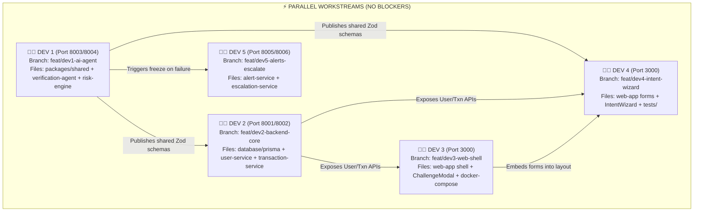

# 👷 PayShield AI — Individual Zero-Conflict Action Roadmaps (DEV 1 to DEV 5)

> This document is the **individual tactical handbook** for each of the 5 team members.  
> Every developer has an isolated folder scope, a dedicated git branch, pre-assigned port, and clear dependency handshakes so **nobody blocks anyone else and zero merge conflicts occur**.

---

## 🤝 The Zero-Conflict Handshake Protocol



---

## 👨‍💻 DEV 1 — Tech Lead: GenAI Agent, Risk Engine & Security

* **Git Branch**: `feat/dev1-genai-agent`
* **Assigned Ports**: `8003` (Verification Agent), `8004` (Risk Engine)
* **Exclusive Directory Scope**:
  * `packages/shared/`
  * `services/verification-agent/`
  * `services/risk-engine/`

### 📋 DEV 1 Day-by-Day Action Checklist

#### SPRINT 1: Shared Core & Foundation (Week 1–3)
- [ ] Initialize `packages/shared/src/schemas/`:
  - `user.schema.ts` (Registration and login Zod schemas).
  - `intent-form.schema.ts` (10 personal memory anchors schema).
  - `transaction.schema.ts` (Payment payload schema).
  - `verification.schema.ts` (Gemini challenge & answer schemas).
- [ ] Build `packages/shared/src/security/`:
  - `argon2-hasher.ts` (`@node-rs/argon2` hash/verify functions).
  - `aes-encryptor.ts` (Node Web Crypto AES-256-GCM encrypt/decrypt with random IV).
  - `jwt-manager.ts` (Sign & verify asymmetric RS256 JWTs).
- [ ] Notify DEV 2 & DEV 4 that shared schemas are ready to import.

#### SPRINT 2: Fastify Skeletons & Redis 10s Timer (Week 4–6)
- [ ] Setup `services/verification-agent/src/index.ts` on Fastify (Port 8003).
- [ ] Setup `services/risk-engine/src/index.ts` on Fastify (Port 8004).
- [ ] In `verification-agent/src/agent/timer-enforcer.ts`:
  - Implement Redis 10-second TTL logic: `SET challenge:<id> <data> EX 10`.
  - Expose check function: Returns true if key exists, false (timeout) if expired.

#### SPRINT 3: Gemini 1.5 Flash Dynamic Challenge & Evaluator (Week 7–10)
- [ ] In `question-generator.ts`:
  - Connect to Google Gemini 1.5 Flash using `@ai-sdk/google` and Vercel AI SDK.
  - Implement prompt: Turns secret memory into an unpredictable riddle in $< 350\text{ms}$.
  - Enforce 7-day cooldown query to ensure no recent questions repeat.
- [ ] In `answer-evaluator.ts`:
  - Implement `generateObject` with Zod schema (`is_verified`, `confidence`, `reasoning`).
  - Configure LLM-as-a-judge system prompt: Tolerates casual phrasing and typos, rejects wrong guesses.

#### SPRINT 4: Advanced LangGraph & RAG Integration (Week 11–15)
- [ ] Assemble LangGraph `StateGraph`:
  - Nodes: `assess_risk` $\rightarrow$ `rag_memory_lookup` $\rightarrow$ `formulate_riddle` $\rightarrow$ `10s_interrupt` $\rightarrow$ `evaluate_answer`.
  - Conditional edge: If score $\ge 0.85 \rightarrow$ APPROVE; If $0.60–0.84 \rightarrow$ adaptive micro-question; If $< 0.60$ or timeout $\rightarrow$ ESCALATE.
- [ ] Setup `text-embedding-004` to semantically match transaction context (food, travel, luxury) with appropriate secret category.

---

## 👩‍💻 DEV 2 — Backend & Database Engineer: Ledgers, Users & PayPal

* **Git Branch**: `feat/dev2-backend-ledgers`
* **Assigned Ports**: `8001` (User Service), `8002` (Transaction Service)
* **Exclusive Directory Scope**:
  * `database/prisma/`
  * `database/mongodb/`
  * `database/seeds/`
  * `services/user-service/`
  * `services/transaction-service/`

### 📋 DEV 2 Day-by-Day Action Checklist

#### SPRINT 1: Database Schemas & Migrations (Week 1–3)
- [ ] Initialize Prisma in `database/prisma/schema.prisma` with models:
  - `User`, `Device`, `Transaction`, `VerificationAttempt`, `FraudIncident`, `AlertLog`.
- [ ] Connect to cloud PostgreSQL (Supabase `DATABASE_URL`) and run `npx prisma db push` or `prisma migrate dev`.
- [ ] Setup MongoDB Atlas connection (`MONGODB_URI`) and create collection `intent_forms`.
- [ ] Write `database/seeds/seed-demo-data.ts` to pre-seed 2 test users.

#### SPRINT 2: User Service Endpoints (Week 4–6)
- [ ] In `services/user-service/` (Port 8001):
  - `POST /api/v1/auth/register` (Hashes password with DEV 1's Argon2 utility; stores in Postgres).
  - `POST /api/v1/auth/login` (Verifies password; issues JWT token).
  - `GET /api/v1/users/me` (Returns authenticated user profile).
  - `POST /api/v1/intent-form/setup` (Encrypts 10 memory anchors with DEV 1's AES utility and saves to MongoDB).

#### SPRINT 3: PayPal SDK & Transaction Orchestration (Week 7–10)
- [ ] Install `@paypal/checkout-server-sdk` in `services/transaction-service/` (Port 8002).
- [ ] In `payment-orchestrator.ts`:
  - `POST /api/v1/paypal/create-order`: Calls PayPal REST API to create an authorized order.
  - Interception logic: Calls DEV 1's Risk Engine (`POST :8004/api/v1/risk/score`).
  - If Risk $< 0.30 \rightarrow$ Immediately captures order with PayPal SDK.
  - If Risk $\ge 0.30 \rightarrow$ Returns `{ status: "VERIFICATION_REQUIRED", challengeToken }`.
  - `POST /api/v1/paypal/capture-order`: Triggered once DEV 1's agent verifies identity.
  - `POST /api/v1/paypal/void-order`: Triggered if verification fails or times out.

#### SPRINT 4: Performance & Query Optimization (Week 11–15)
- [ ] Add Prisma connection pooling and configure index tuning on `userId` and `transactionId`.
- [ ] Build transaction history pagination endpoint: `GET /api/v1/transactions/history`.

---

## 👨‍💻 DEV 3 — Frontend Lead & DevOps: Next.js Shell, 10s Modal & Containers

* **Git Branch**: `feat/dev3-frontend-devops`
* **Assigned Ports**: `3000` (Next.js Web App)
* **Exclusive Directory Scope**:
  * `web-app/src/app/layout.tsx`
  * `web-app/src/app/page.tsx`
  * `web-app/src/app/(dashboard)/`
  * `web-app/src/components/layout/`
  * `web-app/src/components/verification/ChallengeModal.tsx`
  * `web-app/src/lib/api-client.ts`
  * `web-app/src/hooks/useVerification.ts`
  * `docker-compose.yml`
  * `.github/workflows/`

### 📋 DEV 3 Day-by-Day Action Checklist

#### SPRINT 1: Monorepo Next.js 15 Shell (Week 1–3)
- [ ] Setup Next.js 15 app in `web-app/` with TypeScript, Tailwind CSS, and Lucide Icons.
- [ ] Build global layout in `src/app/layout.tsx`:
  - Responsive `Header.tsx` (Logo, user profile avatar, connection status indicator).
  - Collapsible `Sidebar.tsx` (Dashboard, Send Money, Security Settings, Alert History).
- [ ] Build `lib/api-client.ts`:
  - Axios client configured with automatic JWT authorization header injection.
  - Centralized error-handling interceptor.

#### SPRINT 2: The Flagship 10-Second Interactive Challenge Modal (Week 4–6)
- [ ] In `web-app/src/components/verification/ChallengeModal.tsx`:
  - Build animated modal popup triggered when transaction requires verification.
  - **Live Countdown Timer**: 10.0s $\rightarrow$ 0.0s animated progress bar (green $\rightarrow$ yellow $\rightarrow$ pulsing red).
  - Autofocus text input field for immediate typing.
  - Auto-submit trigger when timer hits `0.0s`.
  - Audio/Haptic cue when challenge initiates.
- [ ] Write `useVerification.ts` custom hook to manage modal open/close/timeout state.

#### SPRINT 3: Dashboard & PayPal Button Integration (Week 7–10)
- [ ] Install `@paypal/react-paypal-js` in `web-app/`.
- [ ] Build `transactions/page.tsx`:
  - Transfer amount input & recipient selector.
  - Official PayPal Button component (`<PayPalButtons />`) calling DEV 2's backend endpoints.
- [ ] Build Dashboard overview cards (`BalanceCards.tsx`, `TransactionList.tsx`).

#### SPRINT 4: Dockerization & CI/CD Pipeline (Week 11–15)
- [ ] Author multi-stage `Dockerfile` for each microservice and Next.js frontend.
- [ ] Author `docker-compose.yml` networking all 6 services + PostgreSQL + MongoDB + Redis.
- [ ] Author `.github/workflows/ci-tests.yml` to run Vitest and Playwright tests on every PR.

---

## 👩‍💻 DEV 4 — UI Developer & QA Lead: Forms, Intent Wizard & Testing

* **Git Branch**: `feat/dev4-wizard-testing`
* **Assigned Ports**: Shares `3000` (Dedicated to isolated page folders & tests)
* **Exclusive Directory Scope**:
  * `web-app/src/app/(auth)/` (Login, Register, Intent Form pages)
  * `web-app/src/components/forms/` (LoginForm, RegisterForm, IntentFormWizard)
  * `web-app/src/app/(dashboard)/security/`
  * `web-app/src/app/(dashboard)/alerts/`
  * `tests/unit/`
  * `tests/integration/`
  * `tests/e2e/`

### 📋 DEV 4 Day-by-Day Action Checklist

#### SPRINT 1: Auth Pages & Component Primitives (Week 1–3)
- [ ] Add Shadcn UI primitives (`npx shadcn add button card input dialog progress tabs toast`).
- [ ] In `web-app/src/components/forms/`:
  - Build `LoginForm.tsx` using React Hook Form + DEV 1's `user.schema.ts`.
  - Build `RegisterForm.tsx` with instant field validation and password strength bar.
- [ ] Build `src/app/(auth)/login/page.tsx` and `register/page.tsx`.

#### SPRINT 2: The Flagship 4-Step Intent Form Wizard (Week 4–6)
- [ ] In `src/components/forms/IntentFormWizard.tsx`:
  - **Step 1 (Category Picker)**: Memory Anchors, Secret Habits, Pattern Sequences.
  - **Step 2 (Prompt Selection)**: Dropdown of 15 suggested prompts + custom prompt builder.
  - **Step 3 (Intimate Answers)**: Clean inputs enforcing concise 1-to-3 word answers with "Tip: Nobody can Google this" hints.
  - **Step 4 (Encryption & Review)**: Shows encrypted payload animation and submits to DEV 2's `POST /api/v1/intent-form/setup`.
- [ ] Build `src/app/(auth)/intent-form/page.tsx` hosting the wizard.

#### SPRINT 3: Security Settings & Alert Center (Week 7–10)
- [ ] Build `src/app/(dashboard)/security/page.tsx`:
  - Allows users to review and update memory prompts.
  - Active trusted devices list with 1-click "Revoke Device" button.
- [ ] Build `src/app/(dashboard)/alerts/page.tsx`:
  - Security notification history table showing blocked fraud attempts, IP locations, and freeze timestamps.

#### SPRINT 4: Full Automated Testing Suite (Week 11–15)
- [ ] Setup **Vitest** in `tests/unit/`:
  - Test DEV 1's Argon2 password hashing and AES-256 encryption.
  - Test DEV 1's Risk Engine scoring thresholds.
- [ ] Setup **Playwright** in `tests/e2e/payment-flow.spec.ts`:
  - Automated browser test: Register $\rightarrow$ Complete Intent Wizard $\rightarrow$ Trigger payment $\rightarrow$ Answer 10s challenge modal $\rightarrow$ Verify approved!
  - Negative test: Enter wrong answer $\rightarrow$ Verify account frozen for 1 hr.

---

## 👨‍💻 DEV 5 — Integrations & Incident Escalation Backend: Alerts & Lockdowns

* **Git Branch**: `feat/dev5-alerts-escalation`
* **Assigned Ports**: `8005` (Alert Service), `8006` (Escalation Service)
* **Exclusive Directory Scope**:
  * `services/alert-service/`
  * `services/escalation-service/`
  * `docs/setup-guide.md`

### 📋 DEV 5 Day-by-Day Action Checklist

#### SPRINT 1: Skeletons & Mock Dispatchers (Week 1–3)
- [ ] Setup Fastify server in `services/alert-service/src/index.ts` (Port 8005).
- [ ] Setup Fastify server in `services/escalation-service/src/index.ts` (Port 8006).
- [ ] Create mock alert functions for SMS and Email with detailed terminal logging.
- [ ] Write `docs/setup-guide.md` explaining how teammates configure `.env` keys.

#### SPRINT 2: Live Multi-Channel Alert Gateway (Week 4–6)
- [ ] In `alert-service/src/channels/`:
  - `twilio-sms.ts`: Initialize Twilio SDK with `TWILIO_ACCOUNT_SID` and send live SMS (*"🚨 PayShield: Unauthorized attempt blocked. Account frozen for 1 hr."*).
  - `sendgrid-email.ts`: Initialize `@sendgrid/mail` with `SENDGRID_API_KEY`.
  - `firebase-push.ts`: Initialize `firebase-admin` for mobile/web push notifications.
- [ ] In `templates/`:
  - Author `fraud-alert.html` (Branded security email showing timestamp, attacker IP, location, and dispute reference number).
  - Author `account-frozen.html` (Explains 1-hour freeze and countdown timer).

#### SPRINT 3: The 1-Hour Account Freeze Engine (Week 7–10)
- [ ] In `services/escalation-service/src/actions/freeze-manager.ts`:
  - Endpoint `POST /api/v1/escalate/freeze`:
    - Executes atomic Prisma update on PostgreSQL:
      ```typescript
      await prisma.user.update({
        where: { id: userId },
        data: {
          isFrozen: true,
          frozenUntil: new Date(Date.now() + 60 * 60 * 1000), // Current time + 1 hour
          frozenReason: reason
        }
      });
      ```
    - Immediately calls Alert Service to dispatch SMS and Email in parallel.
- [ ] In `actions/unfreeze-manager.ts`:
  - Endpoint `POST /api/v1/escalate/unfreeze`: Validates expiration or manual admin unlock.

#### SPRINT 4: Bank Dispute Dossier Exporter (Week 11–15)
- [ ] In `actions/bank-reporter.ts`:
  - Compiles full forensic package (Transaction ID, Attacker IP, User-Agent, Failed Intent Question, Timestamp, Bank Routing Number) into an automated Bank Dispute Dossier JSON.
  - Exposes `POST /api/v1/escalate/report-to-bank`.
- [ ] In `actions/ip-blocker.ts`:
  - Records offending IP into PostgreSQL blocklist table and triggers edge WAF blocking.

---

## 📌 Summary: Weekly Sync & Zero-Conflict Rules

1. **Strict File Boundaries**: No developer modifies code outside their designated directory scope without consulting the owner.
2. **Type Changes Go Through DEV 1**: If a service needs a new field in a request or response, DEV 1 updates `packages/shared/src/schemas/`, and others pull.
3. **Always Run Branch-Specific Commits**: Everyone works on their `feat/devX-...` branch and creates Pull Requests into `develop`. DEV 1 merges after automated tests pass.

---

*PayShield AI Action Roadmaps — November 2026*
