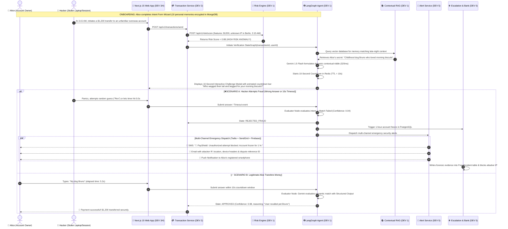

# 📖 PayShield AI — The Master Story, Architectural Guide & Project Trade-Offs

---

## 🌟 The Complete Story: Real-World Scenario



---

## 💎 The Goodness: Strengths, Uniqueness & Societal Impact

### 1. Verification of the *Person*, Not Just the *Credential*
Traditional authentication (passwords, PINs, OTPs, session cookies) only verifies that a device possesses a credential. If the laptop is stolen or unlocked, credentials fail. PayShield's **Intent Protocol** verifies **cognitive human memory** that exists only inside the legitimate user's mind.

### 2. The 10-Second Human-Centric Window
* **Human Feasibility:** Normal users take **5 to 8 seconds** to read a personal prompt and type a 1-to-3 word response.
* **Adversarial Paralysis:** A remote hacker, botnet, or unauthorized acquaintance cannot research, phish, or social-engineer intimate personal memories within 10 seconds.
* **Sub-Second GenAI Speed:** Gemini 1.5 Flash executes in $< 400\text{ms}$, giving the user more than 9 full seconds of exclusive interaction time.

### 3. Contextual RAG Memory Retrieval
Instead of asking predictable security questions, **RAG semantic search** connects the transaction context (late-night food, flight tickets, luxury electronics) to the most semantically relevant personal memory anchor, making challenges unpredictable.

### 4. Zero-Knowledge Security Segmentation
Personal secret memories are encrypted with **AES-256-GCM** and stored in **MongoDB**, physically separated from financial ledgers in **PostgreSQL**. Even a full SQL injection exploit on the banking ledger cannot reveal the user's secret answers.

### 5. Automated Defense Without Human Support Delay
When an attack occurs, PayShield does not wait for a bank call center. In $< 500\text{ms}$, it executes an atomic **1-hour account freeze**, dispatches **multi-channel alerts**, and compiles a **Bank Dispute Dossier**.

---

## ⚠️ The Drawbacks & Real-World Challenges (With Concrete Mitigations)

Every real-world security architecture has trade-offs. Here is how PayShield anticipates and mitigates them:

| Challenge / Drawback | The Risk | How PayShield Solves It (Mitigation) |
|---|---|---|
| **1. User Memory Decay (Forgetfulness)** | What if the legitimate user forgets what they wrote 8 months ago? | **Adaptive Onboarding & Periodic Refresh:** Users configure 10 secrets; RAG only picks high-salience anchors. During normal, low-risk logins, the app offers friendly 1-click memory refresh prompts. |
| **2. Emergency Fallback Flow** | What if the user is truly locked out or forgot their secret? | **Tiered Recovery Protocol:** If locked out, user triggers an identity recovery flow requiring a video biometric selfie or trusted device verification to unfreeze without customer support delays. |
| **3. External LLM API Outage** | What if Google Gemini API experiences latency or downtime? | **Deterministic Circuit Breaker:** If Gemini API latency exceeds $1,200\text{ms}$ or fails, the Verification Agent falls back to an encrypted exact-hash string comparison locally in Fastify. |
| **4. User Panic / Accessibility** | Elderly, disabled, or non-tech users might panic under a 10s timer. | **Accessibility Accommodations:** Users can enable accessibility settings in their profile (extending the timer to 20s with stricter multi-factor biometric backup requirements). |
| **5. Shoulder Surfing** | What if an attacker is physically looking over the user's shoulder? | **Masked Input & Tap Options:** Sensitive challenge answers can be typed in masked bullet format (`••••••`) or answered via a single-tap multiple-choice pattern. |
| **6. User Friction on Small Payments** | Nobody wants a security riddle when buying a \$2 coffee. | **Risk-Gated Triggering:** Transactions under \$50 on trusted devices with risk score $< 0.30$ are **auto-approved in 50ms**, completely bypassing the challenge. 90% of routine payments have zero friction! |

---

## 🧩 Architectural Summary

```
[Web App (Next.js 15 - Port 3000)]
        │ 1. POST /transactions/send
        ▼
[Transaction Service (Fastify - Port 8002)]
        │ 2. POST /risk/score
        ▼
[Risk Engine (Fastify - Port 8004)] ──(Risk ≥ 0.30)──► [Transaction Service]
                                                               │ 3. Invokes Graph
                                                               ▼
[Web App 10s Modal] ◄──(Shows Dynamic Riddle)─── [LangGraph Agent (Port 8003)]
        │ 4. Submits Answer within 10s
        ▼
[LangGraph Agent: Evaluator Node]
   ├── If Correct ──► [Transaction Service] ──► Status: "APPROVED" ──► Funds Moved ✅
   └── If Wrong   ──► [Escalation Service (Port 8006)] ──► Account Frozen for 1 hr in PostgreSQL ❄️
                     └──► [Alert Service (Port 8005)]      ──► SMS + Email Dispatched 🚨
```

---

*PayShield AI Master Story & Trade-Offs Guide — November 2026*
