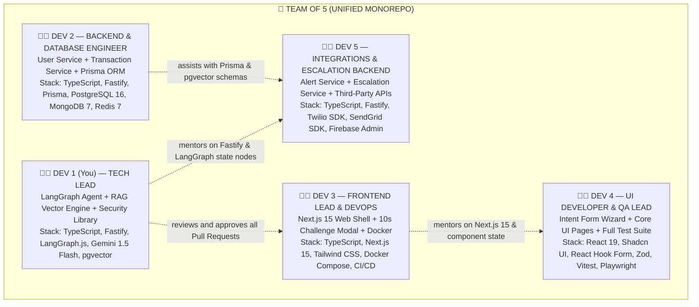

# 🗺️ PayShield AI — Master Project Roadmap & Monorepo Architecture (Final Edition)

> **Final Production Blueprint:** Full-Stack TypeScript (Node.js 22 LTS / Fastify / Next.js 15)  
> **Advanced Intelligence:** LangGraph.js Stateful Agent + Contextual RAG Memory Retrieval + Google Gemini 1.5 Flash  
> **Challenge Standard:** 10-Second Real-Time Adaptive Verification Window

---

## 1. Team Ownership & Mentorship Structure (Zero Conflict)



---

## 2. Complete Monorepo Project File Structure

Every single file in this directory tree has **exactly one designated owner**:

```
payshield-ai/
│
├── packages/shared/                     👨‍💻 OWNER: DEV 1 (Tech Lead)
│   ├── src/
│   │   ├── security/
│   │   │   ├── argon2-hasher.ts         # Rust-compiled Argon2id password hashing
│   │   │   ├── aes-encryptor.ts         # Node Web Crypto AES-256-GCM encryption/decryption
│   │   │   └── jwt-manager.ts           # RS256 JWT creation, signing & verification
│   │   ├── schemas/
│   │   │   ├── user.schema.ts           # Shared Zod validation schema for registration & login
│   │   │   ├── transaction.schema.ts    # Shared Zod validation schema for payments
│   │   │   ├── intent-form.schema.ts    # Shared Zod schema for 10 personal memory secrets
│   │   │   └── verification.schema.ts   # Shared Zod schema for LangGraph agent challenge/answer
│   │   └── types/
│   │       └── index.ts                 # Centralized TypeScript definitions shared monorepo-wide
│   ├── package.json
│   └── tsconfig.json
│
├── services/verification-agent/         👨‍💻 OWNER: DEV 1 (Tech Lead)
│   ├── src/
│   │   ├── index.ts                     # Fastify server entry (Port 8003)
│   │   ├── config/
│   │   │   ├── gemini.config.ts         # Google Gemini 1.5 Flash & text-embedding-004 setup
│   │   │   └── redis.config.ts          # ioredis connection for 10s countdown timer
│   │   ├── graph/
│   │   │   ├── state.ts                 # LangGraph state definition (Annotation.Root)
│   │   │   ├── verification-graph.ts    # Master LangGraph state machine with conditional routing
│   │   │   └── nodes/
│   │   │       ├── rag-retriever.ts     # Node: RAG similarity search on memory anchors
│   │   │       ├── challenge-node.ts    # Node: Gemini generates contextual riddle in <350ms
│   │   │       ├── interrupt-timer.ts   # Node: LangGraph human-in-the-loop 10s wait state
│   │   │       ├── evaluator-node.ts    # Node: LLM-as-a-judge semantic intent verification
│   │   │       ├── adaptive-followup.ts # Node: Micro-challenge for borderline answers (60-84%)
│   │   │       └── forensic-node.ts     # Node: Compiles Bank Dispute Dossier on failure
│   │   ├── routes/
│   │   │   ├── challenge.route.ts       # POST /api/v1/verify/challenge (initiates graph)
│   │   │   └── answer.route.ts          # POST /api/v1/verify/answer (resumes graph with user input)
│   │   └── types/
│   ├── package.json
│   ├── tsconfig.json
│   └── Dockerfile
│
├── services/risk-engine/                👨‍💻 OWNER: DEV 1 (Tech Lead)
│   ├── src/
│   │   ├── index.ts                     # Fastify server entry (Port 8004)
│   │   ├── scoring/
│   │   │   ├── heuristic-calculator.ts  # Evaluates amount, midnight hours, device, and IP
│   │   │   ├── device-fingerprint.ts    # Browser/hardware hash anomaly detection
│   │   │   └── geo-velocity.ts          # Impossible travel velocity check (e.g., NY to London in 1 hr)
│   │   ├── routes/
│   │   │   └── score.route.ts           # POST /api/v1/risk/score (returns risk 0.00-1.00)
│   │   └── types/
│   ├── package.json
│   ├── tsconfig.json
│   └── Dockerfile
│
├── services/user-service/               👩‍💻 OWNER: DEV 2 (Backend & Database)
│   ├── src/
│   │   ├── index.ts                     # Fastify server entry (Port 8001)
│   │   ├── routes/
│   │   │   ├── auth.route.ts            # POST /auth/register & POST /auth/login
│   │   │   ├── profile.route.ts         # GET/PUT /users/me
│   │   │   ├── intent-form.route.ts     # POST /intent-form/setup (saves encrypted secrets)
│   │   │   └── devices.route.ts         # GET/POST /users/me/devices
│   │   └── repositories/
│   │       ├── user.repository.ts       # Prisma PostgreSQL queries
│   │       └── intent.repository.ts     # MongoDB encrypted memory anchor repository
│   ├── package.json
│   ├── tsconfig.json
│   └── Dockerfile
│
├── services/transaction-service/        👩‍💻 OWNER: DEV 2 (Backend & Database)
│   ├── src/
│   │   ├── index.ts                     # Fastify server entry (Port 8002)
│   │   ├── orchestrator/
│   │   │   └── payment-orchestrator.ts  # Links Txn -> Risk Engine -> Verification Agent
│   │   ├── routes/
│   │   │   ├── send.route.ts            # POST /transactions/send (initiates payment)
│   │   │   ├── history.route.ts         # GET /transactions/history
│   │   │   ├── approve.route.ts         # POST /transactions/:id/approve
│   │   │   └── reject.route.ts          # POST /transactions/:id/reject
│   │   └── repositories/
│   │       └── transaction.repo.ts      # Prisma transaction ledger queries
│   ├── package.json
│   ├── tsconfig.json
│   └── Dockerfile
│
├── database/                            👩‍💻 OWNER: DEV 2 (Backend & Database)
│   ├── prisma/
│   │   ├── schema.prisma                # PostgreSQL schema with pgvector vector support
│   │   └── migrations/                  # Version-controlled Prisma database migrations
│   ├── mongodb/
│   │   └── init-intent-forms.js         # MongoDB collection indexes for intent vault
│   └── seeds/
│       └── seed-demo-data.ts            # Seed realistic users, cards, and transactions
│
├── services/alert-service/              👨‍💻 OWNER: DEV 5 (Integrations Backend)
│   ├── src/
│   │   ├── index.ts                     # Fastify server entry (Port 8005)
│   │   ├── channels/
│   │   │   ├── twilio-sms.ts            # Twilio Node SDK SMS notification dispatcher
│   │   │   ├── sendgrid-email.ts        # SendGrid Mail HTML incident evidence dispatcher
│   │   │   └── firebase-push.ts         # Firebase Admin SDK mobile/web push alerts
│   │   ├── templates/
│   │   │   ├── fraud-alert.html         # Rich HTML email template for blocked attempts
│   │   │   └── account-frozen.html      # 1-hour account freeze notification email
│   │   └── routes/
│   │       ├── send-alert.route.ts      # POST /api/v1/alerts/send
│   │       └── alert-history.route.ts   # GET /api/v1/alerts/history/:userId
│   ├── package.json
│   ├── tsconfig.json
│   └── Dockerfile
│
├── services/escalation-service/         👨‍💻 OWNER: DEV 5 (Integrations Backend)
│   ├── src/
│   │   ├── index.ts                     # Fastify server entry (Port 8006)
│   │   ├── actions/
│   │   │   ├── freeze-manager.ts        # Updates PostgreSQL: is_frozen = true (1 hr)
│   │   │   ├── unfreeze-manager.ts      # Restores account access upon expiration/manual review
│   │   │   ├── bank-reporter.ts         # Packages incident data for bank fraud teams
│   │   │   └── ip-blocker.ts            # Adds attacker IP to PostgreSQL blocklist table
│   │   └── routes/
│   │       ├── freeze.route.ts          # POST /api/v1/escalate/freeze
│   │       ├── unfreeze.route.ts        # POST /api/v1/escalate/unfreeze
│   │       └── report.route.ts          # POST /api/v1/escalate/report-to-bank
│   ├── package.json
│   ├── tsconfig.json
│   └── Dockerfile
│
├── web-app/                             👨‍💻 DEV 3 (Architecture) + 👩‍💻 DEV 4 (Pages)
│   ├── src/
│   │   ├── app/
│   │   │   ├── layout.tsx               # DEV 3 — Root layout with navigation & providers
│   │   │   ├── page.tsx                 # DEV 3 — Landing page
│   │   │   ├── (auth)/
│   │   │   │   ├── login/page.tsx       # DEV 4 — User login page
│   │   │   │   ├── register/page.tsx    # DEV 4 — User registration page
│   │   │   │   └── intent-form/page.tsx # DEV 4 — Flagship Intent Form wizard page
│   │   │   ├── (dashboard)/
│   │   │   │   ├── layout.tsx           # DEV 3 — Dashboard layout with sidebar
│   │   │   │   ├── page.tsx             # DEV 3 — Dashboard home overview
│   │   │   │   ├── transactions/page.tsx# DEV 3 — Send money & transaction ledger
│   │   │   │   ├── security/page.tsx    # DEV 4 — Security settings & secret management
│   │   │   │   └── alerts/page.tsx      # DEV 4 — Incident alerts & freeze status
│   │   │   └── api/
│   │   │       └── proxy/               # DEV 3 — Next.js route handlers proxying backend APIs
│   │   ├── components/
│   │   │   ├── layout/
│   │   │   │   ├── Header.tsx           # DEV 3 — Top navigation bar
│   │   │   │   └── Sidebar.tsx          # DEV 3 — Left sidebar
│   │   │   ├── forms/
│   │   │   │   ├── LoginForm.tsx        # DEV 4 — Login form component
│   │   │   │   ├── RegisterForm.tsx     # DEV 4 — Registration form component
│   │   │   │   └── IntentFormWizard.tsx # DEV 4 — Multi-step intent wizard component
│   │   │   ├── verification/
│   │   │   │   ├── ChallengeModal.tsx   # DEV 3 — 10-second interactive countdown modal
│   │   │   │   └── ResultBanner.tsx     # DEV 4 — Verification result alert banner
│   │   │   ├── dashboard/
│   │   │   │   ├── BalanceCards.tsx     # DEV 3 — Balance and wallet cards
│   │   │   │   └── TransactionList.tsx  # DEV 3 — Transaction history table
│   │   │   └── ui/                      # DEV 4 — Shadcn UI primitives (Button, Dialog, Input)
│   │   ├── lib/
│   │   │   ├── api-client.ts            # DEV 3 — Centralized Axios API client wrapper
│   │   │   └── auth-session.ts          # DEV 3 — Token storage & auth state guards
│   │   └── hooks/
│   │       ├── useAuth.ts               # DEV 3 — Client auth state hook
│   │       └── useVerification.ts       # DEV 3 — 10-second verification challenge hook
│   ├── tailwind.config.ts
│   ├── next.config.ts
│   ├── package.json
│   ├── tsconfig.json
│   └── Dockerfile
│
├── tests/                               👩‍💻 OWNER: DEV 4 (QA Lead) + DEV 5
│   ├── unit/
│   │   ├── security.test.ts             # DEV 4 — Vitest: Argon2id & AES-256-GCM tests
│   │   ├── risk-engine.test.ts          # DEV 4 — Vitest: Risk score heuristic thresholds
│   │   └── langgraph-agent.test.ts      # DEV 4 — Vitest: LangGraph state transitions
│   ├── integration/
│   │   ├── user-service.test.ts         # DEV 4 — Supertest: Registration, login, profile
│   │   ├── transaction-flow.test.ts     # DEV 4 — Supertest: Txn -> Risk -> Verification
│   │   └── alert-escalation.test.ts     # DEV 5 — Supertest: 1-hr freeze and alert dispatch
│   └── e2e/
│       └── payment-flow.spec.ts         # DEV 4 — Playwright: Full browser payment simulation
│
├── docs/                                👩‍💻 OWNER: DEV 4 + DEV 5
│   ├── api-contracts.md                 # DEV 4 — Complete documentation of all endpoints
│   ├── setup-guide.md                   # DEV 5 — Step-by-step local development setup
│   └── architecture-overview.md         # DEV 1 — System design & LangGraph documentation
│
├── scripts/                             👨‍💻 OWNER: DEV 3 (DevOps)
│   ├── dev-all.sh                       # Launches all Fastify microservices + Next.js concurrently
│   └── run-migrations.sh                # Runs Prisma and MongoDB database migrations
│
├── docker-compose.yml                   # DEV 3 — Orchestrates all 6 services + Postgres + Mongo + Redis
├── .github/workflows/
│   ├── ci-tests.yml                     # DEV 3 — Runs Vitest & Playwright on every Pull Request
│   └── cd-deploy.yml                    # DEV 3 — Staging cloud deployment pipeline
├── .env.example                         # DEV 1 — Master environment variables template
├── package.json                         # Root monorepo workspace configuration
├── tsconfig.base.json                   # Shared TypeScript compiler options
└── README.md                            # DEV 4 — Project presentation, badges & setup guide
```

---

## 3. Sprint-by-Sprint Roadmap (20 Weeks)

### PHASE 1: Monorepo Foundation & Core Ledgers (Weeks 1–5)
* **Week 1 (Repo & Monorepo Init):** DEV 1 sets up monorepo and `packages/shared/` crypto utilities; DEV 2 spins up PostgreSQL, MongoDB, and Redis; DEV 3 initializes Next.js 15 app; DEV 4 learns React/TS; DEV 5 sets up Twilio/SendGrid developer accounts.
* **Week 2 (Auth & Migrations):** DEV 1 publishes shared Zod schemas; DEV 2 completes User Service auth endpoints; DEV 3 builds API client; DEV 4 builds Login and Register forms; DEV 5 tests mock SMS alerts.
* **Week 3 (Transaction Core & Intent Wizard):** DEV 1 configures Gemini 1.5 Flash client; DEV 2 builds payment creation endpoint; DEV 3 builds dashboard overview; DEV 4 builds Steps 1 & 2 of the Intent Form Wizard; DEV 5 builds SendGrid email templates.
* **Week 4 (10s Modal & Intent Vault):** DEV 1 builds Redis 10s timer manager; DEV 2 creates `POST /intent-form/setup` with AES-256 encryption in MongoDB; DEV 3 builds `ChallengeModal.tsx` with animated 10s progress bar; DEV 4 completes all steps of the Intent Form Wizard; DEV 5 builds 1-hour freeze action.
* **Week 5 (Phase 1 Integration Milestone):** All services wire together: User registers $\rightarrow$ fills intent form $\rightarrow$ initiates payment $\rightarrow$ high-risk triggers 10s modal $\rightarrow$ wrong answer freezes account in PostgreSQL.

### PHASE 2: Advanced GenAI LangGraph & RAG (Weeks 6–10)
* **Week 6 (RAG Memory Retrieval):** DEV 1 implements RAG vector retrieval in LangGraph, semantically pairing transaction context with user secrets; DEV 2 sets up vector indexes; DEV 3 polishes modal animations; DEV 4 builds security settings page; DEV 5 builds IP blocker.
* **Week 7 (LangGraph State Machine & LLM-as-a-Judge):** DEV 1 builds the complete LangGraph StateGraph with conditional evaluation edges; DEV 2 optimizes Prisma queries; DEV 3 builds alert history page; DEV 4 writes integration tests; DEV 5 connects live Twilio SMS and SendGrid email keys.
* **Week 8 (Security Hardening):** DEV 1 adds Redis rate-limiting (max 3 failed verification attempts before permanent escalation); DEV 2 implements JWT refresh token rotation; DEV 3 adds CSRF and CSP protections; DEV 4 performs security penetration testing; DEV 5 adds alert deduplication.
* **Week 9 (Edge Cases & Fallbacks):** DEV 1 implements 10-second timeout auto-escalation; DEV 2 handles payment edge cases (zero/negative amounts, duplicate nonces); DEV 3 builds offline reconnect screens; DEV 4 logs issues in GitHub Issues; DEV 5 builds SMS-to-Email failover logic.
* **Week 10 (Phase 2 Review & Code Freeze):** Bug-fixing sprint; DEV 1 conducts code review; DEV 2 seeds realistic demo data; DEV 3 writes `scripts/dev-all.sh`; DEV 4 verifies >80% test coverage; DEV 5 finalizes API contracts document.

### PHASE 3: Intelligence & Forensic Packaging (Weeks 11–15)
* **Week 11–12 (Composite Risk Scoring):** DEV 1 upgrades Risk Engine with heuristic weights across 6 signals (amount, device mismatch, geo-velocity, midnight hours, recipient history); DEV 2 adds user behavioral profiling tables; DEV 3 adds visual trust score badges; DEV 4 tests risk thresholds; DEV 5 adds tiered alert severities.
* **Week 13–14 (Forensic Incident Dossier):** DEV 1 builds the LangGraph Forensic Node compiling attacker IP, headers, and failed questions into a Bank Dispute Packet; DEV 2 creates indexed `FraudIncident` tables; DEV 3 builds admin fraud monitoring screens; DEV 4 writes Playwright browser test simulating a blocked attack; DEV 5 builds bank reporting exporter.
* **Week 15 (Performance & Latency Tuning):** DEV 1 optimizes LangGraph node executions to ensure total AI roundtrip is $< 400\text{ms}$; DEV 2 tunes PostgreSQL indexes; DEV 3 optimizes Next.js bundle sizes; DEV 4 runs concurrent load tests; DEV 5 tunes parallel notification dispatches.

### PHASE 4: Containerization, Deployment & Launch (Weeks 16–20)
* **Week 16–17 (Docker & CI/CD):** DEV 3 writes production Dockerfiles and master `docker-compose.yml`; sets up GitHub Actions CI for automated Vitest and Playwright runs; DEV 1 performs cryptographic key audits; DEV 2 writes database backup scripts; DEV 4 executes cross-browser tests; DEV 5 tests alert webhooks in Docker.
* **Week 18–19 (Cloud Deployment):** DEV 3 deploys services to cloud staging (Railway / AWS ECS / Render) with SSL certificates; DEV 2 runs production Prisma migrations; DEV 1 configures cloud environment variables; DEV 4 verifies live URL payments; DEV 5 validates production SMS and email delivery.
* **Week 20 (Final Presentation & Demo):** DEV 1 authors architecture overview; DEV 2 finalizes ER diagrams; DEV 3 records high-resolution product demo video; DEV 4 completes project `README.md`; DEV 5 finalizes setup guide; Team practices the live pitch rehearsal together!

---

*PayShield AI Master Roadmap & File Structure — November 2026*
