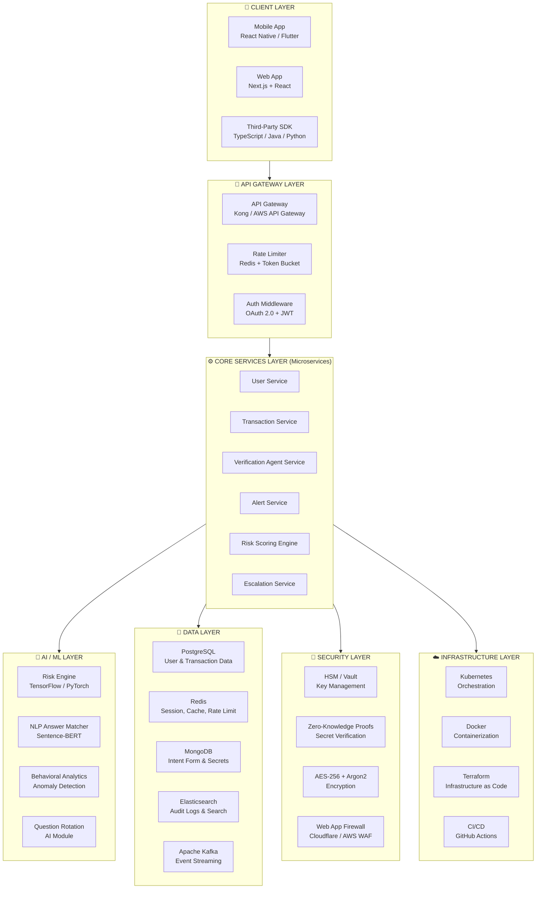
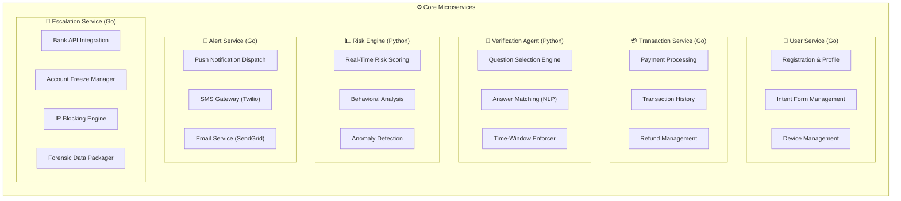
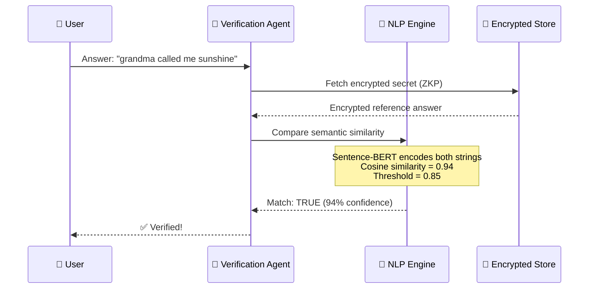
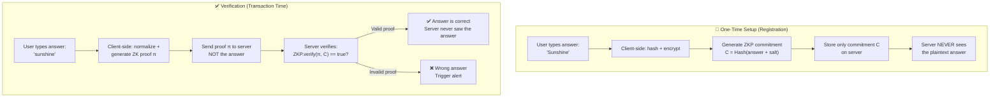
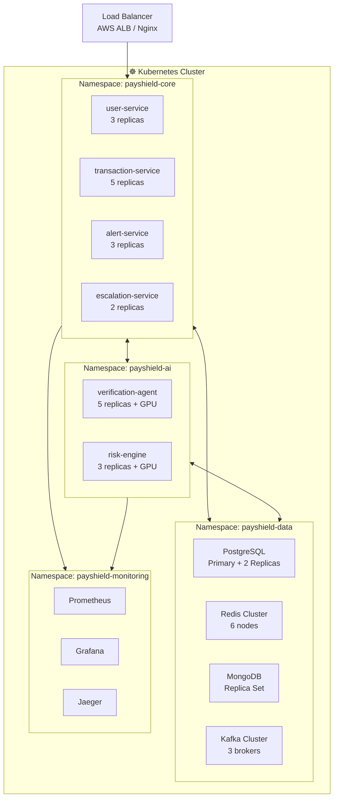
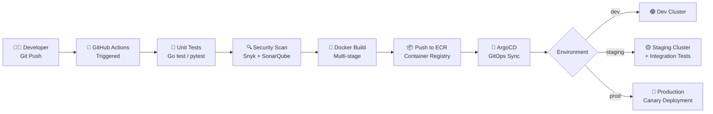
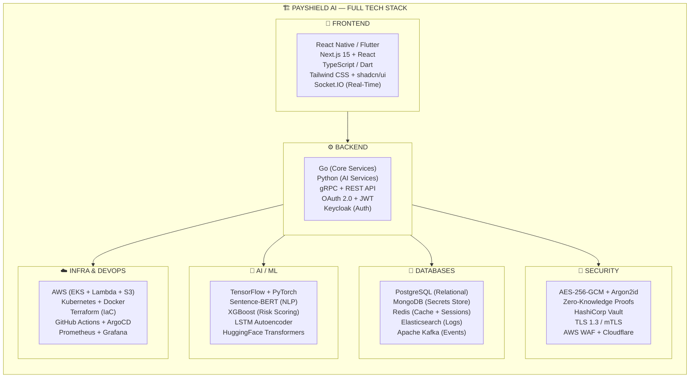

# 🛠️ PayShield AI — Complete Tech Stack & Implementation Blueprint

---

## System Architecture Overview



---

## 1. Frontend — Client Layer

### 1.1 Mobile Application

| Component | Technology | Why This Choice |
|---|---|---|
| **Framework** | **React Native** or **Flutter** | Cross-platform (iOS + Android) from single codebase |
| **Language** | TypeScript (React Native) / Dart (Flutter) | Type safety, fewer runtime errors |
| **State Management** | Redux Toolkit / Zustand (RN) or Riverpod (Flutter) | Predictable state for transaction flows |
| **Local Storage** | React Native MMKV / Flutter Secure Storage | Encrypted local caching for offline mode |
| **Biometric SDK** | `react-native-biometrics` / `local_auth` (Flutter) | Fingerprint & Face ID integration |
| **Push Notifications** | Firebase Cloud Messaging (FCM) | Real-time fraud alerts |
| **Haptic Feedback** | `react-native-haptic-feedback` | For secure haptic-input verification (Gap 3 fix) |
| **Animations** | Lottie / Rive | Smooth 2-4 sec verification UI animations |

### 1.2 Web Application

| Component | Technology | Why This Choice |
|---|---|---|
| **Framework** | **Next.js 15 (App Router)** | SSR, API routes, edge functions — all-in-one |
| **Language** | TypeScript | End-to-end type safety |
| **UI Library** | Tailwind CSS + shadcn/ui | Rapid, consistent UI development |
| **Forms** | React Hook Form + Zod | Validated intent form with schema validation |
| **Real-Time** | WebSocket (Socket.IO) | Live verification challenge & alert feed |
| **Charts/Dashboard** | Recharts or Tremor | Admin dashboard for fraud analytics |

### 1.3 Folder Structure (Next.js Web App)

```
payshield-web/
├── src/
│   ├── app/
│   │   ├── (auth)/
│   │   │   ├── login/page.tsx
│   │   │   ├── register/page.tsx
│   │   │   └── intent-form/page.tsx      # Secret Intent Form setup
│   │   ├── (dashboard)/
│   │   │   ├── transactions/page.tsx
│   │   │   ├── security/page.tsx
│   │   │   └── alerts/page.tsx
│   │   ├── (verification)/
│   │   │   └── challenge/page.tsx         # 2-4 sec verification screen
│   │   └── api/
│   │       ├── auth/[...nextauth]/route.ts
│   │       ├── verify/route.ts
│   │       └── webhook/route.ts
│   ├── components/
│   │   ├── IntentFormWizard.tsx
│   │   ├── VerificationModal.tsx
│   │   ├── AlertBanner.tsx
│   │   └── TransactionCard.tsx
│   ├── lib/
│   │   ├── encryption.ts                 # Client-side encryption utils
│   │   ├── api-client.ts
│   │   └── validators.ts
│   └── hooks/
│       ├── useVerification.ts
│       └── useBiometric.ts
├── public/
├── tailwind.config.ts
├── next.config.ts
└── package.json
```

---

## 2. Backend — Core Microservices

### 2.1 Technology Choices

| Component | Technology | Why This Choice |
|---|---|---|
| **Primary Language** | **Go (Golang)** | High performance, low latency (critical for 2-4 sec window) |
| **Secondary Language** | **Python** | AI/ML services, NLP processing |
| **API Protocol** | **gRPC** (inter-service) + **REST** (client-facing) | gRPC for speed between services; REST for web/mobile |
| **API Documentation** | OpenAPI 3.0 / Swagger | Auto-generated API docs |
| **Auth Framework** | **OAuth 2.0 + OIDC** (via Keycloak) | Industry-standard, supports SSO |
| **Token System** | **JWT (RS256)** + Refresh Tokens | Stateless auth with asymmetric signing |

### 2.2 Microservice Architecture



### 2.3 Backend Folder Structure (Go Microservice)

```
payshield-backend/
├── services/
│   ├── user-service/           # Go
│   │   ├── cmd/server/main.go
│   │   ├── internal/
│   │   │   ├── handler/        # HTTP/gRPC handlers
│   │   │   ├── service/        # Business logic
│   │   │   ├── repository/     # Database layer
│   │   │   └── model/          # Data models
│   │   ├── proto/              # gRPC protobuf definitions
│   │   ├── Dockerfile
│   │   └── go.mod
│   │
│   ├── transaction-service/    # Go (same structure)
│   ├── alert-service/          # Go
│   ├── escalation-service/     # Go
│   │
│   ├── verification-agent/     # Python
│   │   ├── app/
│   │   │   ├── main.py
│   │   │   ├── agent/
│   │   │   │   ├── question_selector.py
│   │   │   │   ├── answer_matcher.py
│   │   │   │   └── time_enforcer.py
│   │   │   ├── models/
│   │   │   ├── routers/
│   │   │   └── config.py
│   │   ├── ml_models/          # Trained model weights
│   │   ├── Dockerfile
│   │   └── requirements.txt
│   │
│   └── risk-engine/            # Python
│       ├── app/
│       │   ├── main.py
│       │   ├── scoring/
│       │   │   ├── risk_calculator.py
│       │   │   ├── behavioral_analyzer.py
│       │   │   └── anomaly_detector.py
│       │   └── models/
│       ├── training/           # ML training scripts
│       ├── Dockerfile
│       └── requirements.txt
│
├── gateway/                    # API Gateway config
│   ├── kong.yml
│   └── rate-limiting.yml
│
├── proto/                      # Shared protobuf definitions
│   ├── user.proto
│   ├── transaction.proto
│   ├── verification.proto
│   └── alert.proto
│
├── docker-compose.yml
├── Makefile
└── README.md
```

---

## 3. AI / Machine Learning Layer

### 3.1 ML Models & Frameworks

| AI Component | Framework | Model / Algorithm | Purpose |
|---|---|---|---|
| **Risk Scoring** | TensorFlow / Scikit-learn | Gradient Boosted Trees (XGBoost) | Score each transaction 0.0–1.0 risk |
| **Answer Matching** | PyTorch + HuggingFace | Sentence-BERT (`all-MiniLM-L6-v2`) | Fuzzy match user answers (handles typos, synonyms) |
| **Behavioral Analytics** | PyTorch | LSTM Autoencoder | Detect anomalous usage patterns |
| **Question Rotation** | Custom Python | Weighted Random + Cooldown Algorithm | Select unpredictable questions each time |
| **NLP Paraphrasing** | HuggingFace Transformers | T5 / Gemini API | Rephrase questions dynamically (anti-social-engineering) |
| **Fraud Pattern Detection** | Apache Spark MLlib | Isolation Forest | Identify new fraud patterns across all users |

### 3.2 How the Answer Matcher Works



### 3.3 Risk Scoring Feature Set

```
Risk Score = f(features) where features include:

TRANSACTION FEATURES:
├── amount                    # Higher amount = higher risk
├── currency                  # Cross-currency = flag
├── recipient_history         # First-time recipient = flag
└── time_of_day               # 3 AM transaction = flag

DEVICE FEATURES:
├── device_id                 # New device = flag
├── device_fingerprint        # Browser/OS/screen hash
├── is_rooted_jailbroken      # Compromised device = high risk
└── vpn_detected              # VPN/proxy = flag

LOCATION FEATURES:
├── ip_geolocation            # New country = flag
├── gps_coordinates           # Impossible travel = flag
└── distance_from_usual       # How far from normal location

BEHAVIORAL FEATURES:
├── typing_speed              # Faster/slower than baseline
├── session_duration          # Unusually short session
├── navigation_pattern        # Skipped usual screens
└── transaction_frequency     # Burst of transactions = flag

OUTPUT: risk_score ∈ [0.0, 1.0]
├── 0.0 - 0.3  → LOW    → Auto-approve
├── 0.3 - 0.7  → MEDIUM → 1 secret question
└── 0.7 - 1.0  → HIGH   → 2-3 questions + biometric
```

---

## 4. Database Layer

### 4.1 Database Architecture

| Database | Technology | What It Stores | Why This DB |
|---|---|---|---|
| **Primary Relational** | PostgreSQL 16 | Users, transactions, accounts, bank links | ACID compliance, financial data integrity |
| **Secret Storage** | MongoDB (Encrypted) | Intent form answers, secret categories | Flexible schema for varied question types |
| **Cache & Sessions** | Redis 7 | Active sessions, rate limits, OTP codes, temp locks | Sub-millisecond reads for real-time verification |
| **Search & Audit** | Elasticsearch 8 | Fraud logs, audit trail, forensic data | Full-text search on incident reports |
| **Event Streaming** | Apache Kafka | Transaction events, alert events, ML pipeline feeds | Async event-driven communication between services |
| **ML Feature Store** | Feast + Redis | Pre-computed features for risk scoring | Low-latency feature serving for real-time ML |

### 4.2 Key Database Schemas

```sql
-- PostgreSQL: Users Table
CREATE TABLE users (
    id              UUID PRIMARY KEY DEFAULT gen_random_uuid(),
    email           VARCHAR(255) UNIQUE NOT NULL,
    phone           VARCHAR(20) UNIQUE NOT NULL,
    password_hash   TEXT NOT NULL,           -- Argon2id hash
    kyc_status      VARCHAR(20) DEFAULT 'pending',
    risk_tier       VARCHAR(10) DEFAULT 'standard',
    is_frozen       BOOLEAN DEFAULT FALSE,
    frozen_until    TIMESTAMP,
    frozen_reason   TEXT,
    created_at      TIMESTAMP DEFAULT NOW(),
    updated_at      TIMESTAMP DEFAULT NOW()
);

-- PostgreSQL: Transactions Table
CREATE TABLE transactions (
    id              UUID PRIMARY KEY DEFAULT gen_random_uuid(),
    sender_id       UUID REFERENCES users(id),
    receiver_id     UUID REFERENCES users(id),
    amount          DECIMAL(15,2) NOT NULL,
    currency        VARCHAR(3) DEFAULT 'USD',
    status          VARCHAR(20) DEFAULT 'pending',
    risk_score      DECIMAL(3,2),            -- 0.00 to 1.00
    verification    VARCHAR(20),             -- 'auto', 'secret_q', 'biometric'
    device_id       VARCHAR(255),
    ip_address      INET,
    geolocation     JSONB,
    created_at      TIMESTAMP DEFAULT NOW()
);

-- PostgreSQL: Verification Attempts
CREATE TABLE verification_attempts (
    id              UUID PRIMARY KEY DEFAULT gen_random_uuid(),
    transaction_id  UUID REFERENCES transactions(id),
    user_id         UUID REFERENCES users(id),
    question_id     UUID,
    is_correct      BOOLEAN,
    response_time   INTEGER,                 -- milliseconds
    attempt_number  INTEGER,
    ip_address      INET,
    device_fingerprint TEXT,
    created_at      TIMESTAMP DEFAULT NOW()
);

-- PostgreSQL: Fraud Incidents
CREATE TABLE fraud_incidents (
    id              UUID PRIMARY KEY DEFAULT gen_random_uuid(),
    user_id         UUID REFERENCES users(id),
    transaction_id  UUID REFERENCES transactions(id),
    incident_type   VARCHAR(50),             -- 'failed_verification', 'anomaly_detected'
    severity        VARCHAR(10),             -- 'low', 'medium', 'high', 'critical'
    attacker_ip     INET,
    attacker_device JSONB,
    forensic_data   JSONB,
    status          VARCHAR(20) DEFAULT 'open',
    escalated_to    VARCHAR(50),             -- 'bank_authority', 'law_enforcement'
    resolved_at     TIMESTAMP,
    created_at      TIMESTAMP DEFAULT NOW()
);
```

```javascript
// MongoDB: Intent Form (Secret Questions & Answers)
{
  _id: ObjectId,
  user_id: "uuid-ref",
  secrets: [
    {
      id: "uuid",
      category: "memory_anchor",           // memory_anchor | preference | pattern_key | dynamic
      question: "What did your grandmother call you?",
      answer_hash: "encrypted_with_zkp",   // NEVER stored in plaintext
      answer_embedding: [0.12, -0.34, ...], // Sentence-BERT vector (encrypted)
      last_used: ISODate,
      use_count: 3,
      cooldown_until: ISODate,             // Can't be asked again until this date
      created_at: ISODate
    }
    // ... 10-15 secrets total
  ],
  behavioral_baseline: {
    avg_typing_speed: 45.2,                // words per minute
    avg_session_duration: 340,             // seconds
    usual_active_hours: [9, 22],           // 9 AM - 10 PM
    common_locations: [
      { lat: 28.6139, lng: 77.2090, label: "home" },
      { lat: 28.5355, lng: 77.3910, label: "office" }
    ],
    common_devices: ["device_fingerprint_1", "device_fingerprint_2"]
  },
  updated_at: ISODate
}
```

---

## 5. Security Layer

### 5.1 Security Technologies

| Security Concern | Technology | Implementation |
|---|---|---|
| **Secret Encryption** | AES-256-GCM | All intent form answers encrypted at rest |
| **Password Hashing** | Argon2id | Memory-hard hashing (resists GPU attacks) |
| **Zero-Knowledge Proof** | zk-SNARKs (via `snarkjs`) | Verify answer correctness WITHOUT decrypting the answer |
| **TLS/mTLS** | TLS 1.3 | All inter-service + client-server communication encrypted |
| **Key Management** | HashiCorp Vault | Centralized secrets management, key rotation |
| **API Security** | OAuth 2.0 + PKCE | Secure token-based API authentication |
| **DDoS Protection** | Cloudflare / AWS Shield | Rate limiting + traffic filtering |
| **Web App Firewall** | AWS WAF / Cloudflare WAF | SQL injection, XSS, bot protection |
| **Code Security** | Snyk + SonarQube | Dependency scanning + static analysis |
| **Penetration Testing** | OWASP ZAP + Burp Suite | Automated + manual security testing |

### 5.2 Zero-Knowledge Proof — How Secrets Are Verified Without Exposure



> [!CAUTION]
> **Critical Rule:** The plaintext secret answer should NEVER leave the user's device. All matching happens via encrypted embeddings or zero-knowledge proofs. This is the most important security design decision in the entire system.

---

## 6. Infrastructure & DevOps

### 6.1 Cloud Infrastructure

| Component | Technology | Purpose |
|---|---|---|
| **Cloud Provider** | AWS (primary) / GCP (secondary) | Multi-cloud resilience |
| **Container Orchestration** | Kubernetes (EKS) | Auto-scaling microservices |
| **Containerization** | Docker | Consistent environments across dev/staging/prod |
| **Infrastructure as Code** | Terraform | Reproducible infrastructure deployments |
| **CI/CD Pipeline** | GitHub Actions + ArgoCD | Automated build → test → deploy |
| **Monitoring** | Prometheus + Grafana | Real-time metrics and dashboards |
| **Logging** | ELK Stack (Elasticsearch + Logstash + Kibana) | Centralized log aggregation |
| **Tracing** | Jaeger / OpenTelemetry | Distributed tracing across microservices |
| **CDN** | CloudFront / Cloudflare | Static asset delivery + DDoS protection |
| **DNS** | Route 53 | DNS management + health checks |
| **Message Queue** | Apache Kafka / AWS SQS | Async event processing |
| **Serverless Functions** | AWS Lambda | Lightweight tasks (email triggers, scheduled jobs) |

### 6.2 Kubernetes Deployment Architecture



### 6.3 CI/CD Pipeline



---

## 7. Third-Party Services & APIs

| Service | Provider | Purpose | Cost Estimate |
|---|---|---|---|
| **SMS Alerts** | Twilio | Send fraud alert SMS | ~\$0.0075/SMS |
| **Email Alerts** | SendGrid | Fraud alert + recovery emails | Free tier: 100/day |
| **Push Notifications** | Firebase (FCM) | Real-time mobile alerts | Free |
| **Identity Verification** | Onfido / Jumio | KYC during onboarding | ~\$2-5/verification |
| **Payment Processing** | Stripe / PayPal API | Actual payment routing | 2.9% + \$0.30/txn |
| **Geolocation** | MaxMind GeoIP2 | IP-to-location mapping | ~\$100/month |
| **AI API (Backup)** | Gemini API / OpenAI | NLP fallback, paraphrasing | Pay-per-use |
| **Fraud Database** | SEON / Sift Science | Known fraudster IP/device database | \$500+/month |

---

## 8. Development Tools & Environment

| Category | Tools |
|---|---|
| **IDE** | VS Code / GoLand / PyCharm |
| **Version Control** | Git + GitHub |
| **API Testing** | Postman / Insomnia / Bruno |
| **Database GUI** | pgAdmin (PostgreSQL), MongoDB Compass, RedisInsight |
| **Container Dev** | Docker Desktop + Docker Compose |
| **Local K8s** | Minikube / Kind |
| **Load Testing** | k6 / Locust | 
| **Documentation** | Notion / Confluence + Swagger UI |
| **Design** | Figma (UI/UX) |
| **Project Management** | Jira / Linear |

---

## 9. Complete Tech Stack Summary Table



---

## 10. Implementation Roadmap — Phase-Wise Stack Adoption

### Phase 1: MVP (Month 1–3) — Start Here
| Layer | Build With |
|---|---|
| Frontend | Next.js + React (web only first) |
| Backend | Node.js (Express) — simpler for MVP, migrate to Go later |
| Database | PostgreSQL + Redis |
| AI | Basic keyword matching (no ML yet) |
| Security | AES-256 encryption + bcrypt + JWT |
| Hosting | Docker Compose on a single AWS EC2 / Railway |

### Phase 2: Intelligence (Month 4–6)
| Layer | Upgrade To |
|---|---|
| Frontend | Add React Native mobile app |
| Backend | Migrate core services to Go for performance |
| AI | Integrate Sentence-BERT for fuzzy answer matching |
| AI | Build XGBoost risk scoring model |
| Database | Add MongoDB for intent forms, Kafka for events |
| Security | Integrate HashiCorp Vault, add ZKP library |

### Phase 3: Scale (Month 7–12)
| Layer | Upgrade To |
|---|---|
| Infrastructure | Kubernetes (EKS) + Terraform |
| AI | LSTM behavioral analytics + anomaly detection |
| Monitoring | Full observability stack (Prometheus + Grafana + Jaeger) |
| CI/CD | GitHub Actions + ArgoCD (GitOps) |
| Compliance | PCI-DSS Level 1, GDPR, RBI guidelines |

### Phase 4: Ecosystem (Month 13–18)
| Layer | Upgrade To |
|---|---|
| SDK | Public TypeScript / Python / Java SDK for third-party integration |
| AI | Continuous learning pipeline (MLflow + Feast) |
| Platform | Multi-region deployment (US, EU, India) |
| Business | API marketplace for banks and fintech partners |

---

> [!TIP]
> **Start with Phase 1 (MVP).** Don't over-engineer from day one. A Next.js + Node.js + PostgreSQL stack with basic encryption can demonstrate the core concept in 8-12 weeks. Add Go, ML, and Kubernetes only when you need to scale.

---

*Tech Stack Blueprint v1.0 — PayShield AI — November 2026*
