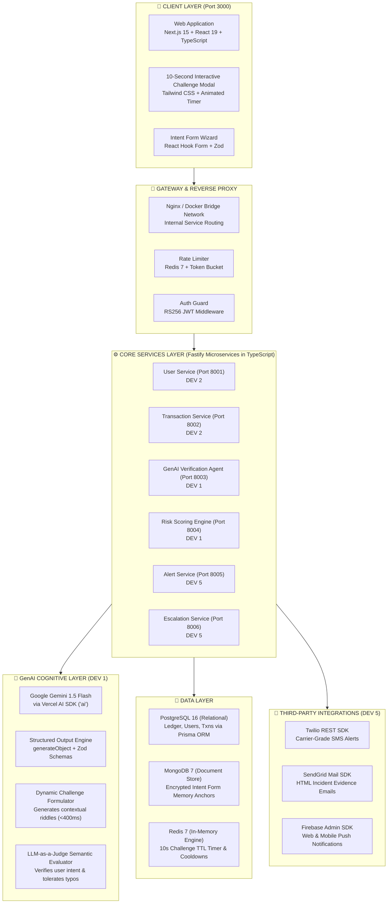

# 🛠️ PayShield AI — Master Tech Stack & Implementation Blueprint (TypeScript Edition)

---

## 1. System Architecture Overview



---

## 2. Core Architectural Decisions

### 2.1 Why Full-Stack TypeScript Across All Services?
1. **Single Unified Language**: All 5 team members code in TypeScript. Eliminates language barriers and prevents context-switching between Python and JavaScript.
2. **Shared Zod Schemas**: Schemas defined once in `packages/shared/` are imported directly by frontend forms (DEV 4) and backend validation handlers (DEV 1, DEV 2, DEV 5).
3. **World-Class GenAI Tooling**: The **Vercel AI SDK (`ai`)** is the premier TypeScript framework for structured AI outputs, integrating natively with Google Gemini 1.5 Flash.

### 2.2 Why the 10-Second Verification Window?
* **Human-Centric Security**: Gives a legitimate user enough time (6–8 seconds) to read, recall, and type a 1-to-3 word secret memory without feeling panicked.
* **Hacker Lockout**: A remote attacker, phishing actor, or automated script cannot research or guess intimate personal memories within 10 seconds.
* **Sub-Second GenAI Speed**: Gemini 1.5 Flash returns structured JSON decisions in **$< 400\text{ms}$**, leaving 9+ seconds purely for the human.

---

## 3. Technology Stack by Component & Owner

| Layer | Technology | Primary Owner | Secondary / Helper | Key Purpose |
|---|---|---|---|---|
| **GenAI Verification Agent** | Fastify, Vercel AI SDK, Gemini 1.5 Flash, Zod, Redis | **DEV 1 (Tech Lead)** | — | Formulates dynamic challenges & verifies semantic intent in $<400\text{ms}$. |
| **Risk Scoring Engine** | Fastify, TypeScript Heuristic Algorithms | **DEV 1 (Tech Lead)** | — | Scores transaction risk ($0.00-1.00$) based on amount, device, hour, and location. |
| **Shared Security Library** | `@node-rs/argon2`, Node Web Crypto, JWT RS256 | **DEV 1 (Tech Lead)** | DEV 2 uses it | Argon2id password hashing, AES-256-GCM secret encryption, JWT tokens. |
| **User Service** | Fastify, Prisma ORM, PostgreSQL, MongoDB | **DEV 2 (Backend)** | DEV 1 reviews | Registration, login, profile management, and device tracking. |
| **Transaction Service** | Fastify, Prisma Client, Txn Orchestrator | **DEV 2 (Backend)** | DEV 1 reviews | Handles transfer requests, checks risk scores, triggers verification agent. |
| **Databases** | PostgreSQL 16, MongoDB 7, Redis 7 | **DEV 2 (Backend)** | — | Prisma migrations, MongoDB collections, and Redis session stores. |
| **Web Application Shell** | Next.js 15 (App Router), React 19, TypeScript | **DEV 3 (Frontend)** | — | App layout, navigation, global auth guard, and API client wrapper. |
| **10s Challenge Modal** | Next.js, Tailwind CSS, Lucide Icons | **DEV 3 (Frontend)** | — | Real-time countdown modal with 10s animated progress bar and auto-submit. |
| **DevOps & Containers** | Docker, Docker Compose, GitHub Actions | **DEV 3 (Frontend)** | DEV 1 reviews | Containerizes all 6 services and databases with a single `docker-compose up`. |
| **Intent Form Wizard** | React Hook Form, Shadcn UI, Zod | **DEV 4 (UI & QA)** | DEV 3 guides | Multi-step onboarding wizard for 10 personal memory anchors. |
| **Auth & Security Pages** | React 19, Tailwind CSS, Shadcn UI | **DEV 4 (UI & QA)** | DEV 3 guides | Login, register, security settings, and alert notification center. |
| **Testing Suite** | Vitest (unit/integration), Playwright (E2E) | **DEV 4 (UI & QA)** | DEV 1 guides | Unit testing for auth/crypto, and headless browser tests for payment flows. |
| **Alert Service** | Fastify, Twilio SDK, SendGrid SDK, Firebase | **DEV 5 (Integrations)** | DEV 1 mentors | Dispatches multi-channel SMS, HTML email, and push notifications. |
| **Escalation Service** | Fastify, Prisma Client (PostgreSQL) | **DEV 5 (Integrations)** | DEV 2 helps | Executes 1-hour account freeze (`is_frozen = true`) and bank report generation. |

---

## 4. Key Database Schemas (Prisma & MongoDB)

### 4.1 PostgreSQL Schema (`database/prisma/schema.prisma`)
```prisma
datasource db {
  provider = "postgresql"
  url      = env("DATABASE_URL")
}

generator client {
  provider = "prisma-client-js"
}

model User {
  id                    String                 @id @default(uuid())
  email                 String                 @unique
  phone                 String                 @unique
  fullName              String
  passwordHash          String
  kycStatus             String                 @default("pending")
  riskTier              String                 @default("standard")
  isFrozen              Boolean                @default(false)
  frozenUntil           DateTime?
  frozenReason          String?
  intentFormCompleted   Boolean                @default(false)
  createdAt             DateTime               @default(now())
  updatedAt             DateTime               @updatedAt
  devices               Device[]
  sentTransactions      Transaction[]          @relation("SentTxns")
  receivedTransactions  Transaction[]          @relation("ReceivedTxns")
  fraudIncidents        FraudIncident[]
  alertLogs             AlertLog[]
}

model Device {
  id                String       @id @default(uuid())
  userId            String
  user              User         @relation(fields: [userId], references: [id], onDelete: Cascade)
  deviceName        String
  deviceFingerprint String       @unique
  osType            String
  isTrusted         Boolean      @default(false)
  lastUsedAt        DateTime     @default(now())
  createdAt         DateTime     @default(now())
}

model Transaction {
  id                  String       @id @default(uuid())
  senderId            String
  receiverId          String
  sender              User         @relation("SentTxns", fields: [senderId], references: [id])
  receiver            User         @relation("ReceivedTxns", fields: [receiverId], references: [id])
  amount              Decimal      @db.Decimal(15, 2)
  currency            String       @default("USD")
  description         String?
  status              String       @default("pending") // pending, verifying, approved, rejected, frozen
  riskScore           Float?
  verificationMethod  String?      // auto, genai_challenge
  ipAddress           String?
  createdAt           DateTime     @default(now())
  attempts            VerificationAttempt[]
  incidents           FraudIncident[]
}

model VerificationAttempt {
  id              String       @id @default(uuid())
  transactionId   String
  transaction     Transaction  @relation(fields: [transactionId], references: [id])
  questionAsked   String
  answerSubmitted String?
  isCorrect       Boolean
  confidence      Float
  responseTimeMs  Int
  createdAt       DateTime     @default(now())
}

model FraudIncident {
  id            String       @id @default(uuid())
  userId        String
  user          User         @relation(fields: [userId], references: [id])
  transactionId String?
  transaction   Transaction? @relation(fields: [transactionId], references: [id])
  incidentType  String       // failed_verification, timeout_lockout
  severity      String       @default("high")
  attackerIp    String?
  forensicData  Json?
  status        String       @default("open") // open, investigated, resolved
  createdAt     DateTime     @default(now())
}

model AlertLog {
  id          String       @id @default(uuid())
  userId      String
  user        User         @relation(fields: [userId], references: [id])
  channel     String       // sms, email, push
  message     String
  delivered   Boolean      @default(false)
  createdAt   DateTime     @default(now())
}
```

---

## 5. Master Microservices Port Allocation

| Port | Service Name | Primary Developer | Primary Responsibilities |
|---|---|---|---|
| **3000** | `web-app` | DEV 3 & DEV 4 | Next.js frontend, Intent Form wizard, 10s challenge popup modal |
| **8001** | `user-service` | DEV 2 | User registration, login, profile, device management, intent form setup |
| **8002** | `transaction-service` | DEV 2 | Money transfer creation, history, orchestration with Risk and Verification |
| **8003** | `verification-agent` | DEV 1 | Gemini 1.5 Flash dynamic questioning, 10s Redis timer, LLM-as-a-judge evaluation |
| **8004** | `risk-engine` | DEV 1 | Real-time transaction risk scoring ($0.00-1.00$), device anomaly detection |
| **8005** | `alert-service` | DEV 5 | Twilio SMS, SendGrid HTML email, and Firebase push notification dispatch |
| **8006** | `escalation-service` | DEV 5 | 1-hour account freeze execution, unfreeze management, bank report packaging |
| **5432** | PostgreSQL 16 | DEV 2 | Relational financial records & audit logs |
| **27017**| MongoDB 7 | DEV 2 | Encrypted Intent Form secret documents |
| **6379** | Redis 7 | DEV 1 & DEV 2 | 10-second challenge timer, rate limiting, and session caching |

---

*PayShield AI Master Tech Stack & Blueprint (TypeScript Edition) — November 2026*
