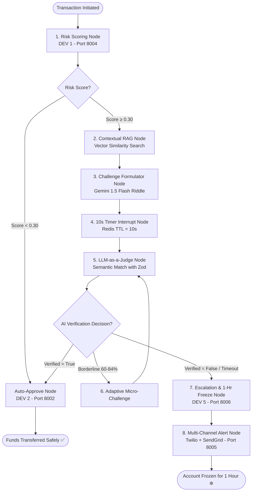
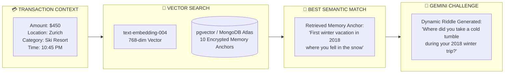
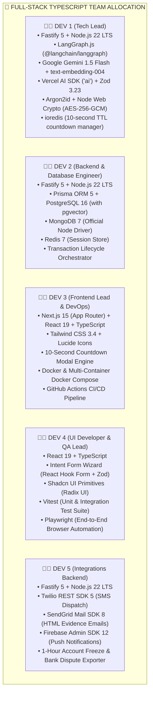

# 🔬 PayShield AI — Master Tech Stack Deep-Dive & Advanced Agent Architecture

---

# PART 1: Advanced Cognitive AI Architecture (LangGraph + RAG + Gemini)

PayShield AI integrates three cutting-edge GenAI paradigms into a single, cohesive security framework:

1. **LangGraph.js (`@langchain/langgraph`)**: Coordinates the multi-step verification state machine with conditional branching and human-in-the-loop interrupts.
2. **Contextual RAG (Retrieval-Augmented Generation)**: Uses vector search (`text-embedding-004`) to semantically match the current transaction context to the most fitting personal memory anchor.
3. **Structured GenAI Reasoner (Google Gemini 1.5 Flash via Vercel AI SDK / LangChain)**: Generates dynamic riddles and performs deterministic semantic evaluation in $< 400\text{ms}$.

---

## 1.1 The LangGraph State Machine Architecture

---

## 1.2 How the Contextual RAG Memory Pipeline Works

---

# PART 2: Comprehensive Tech Stack Breakdown by Team Member

---

## 2.1 DEV 1 (Tech Lead) — Full Tech Stack Deep-Dive

| Technology | Purpose | How DEV 1 Implements It |
|---|---|---|
| **LangGraph.js** | Stateful verification agent workflow | Implements `StateGraph` with nodes: `retrieve_rag`, `formulate_challenge`, `human_interrupt`, `evaluate_answer`, and conditional routing. |
| **Google Gemini 1.5 Flash** | Dynamic challenge formulator & semantic judge | Generates natural contextual riddles and acts as LLM-as-a-judge with sub-400ms latency. |
| **Vercel AI SDK (`ai`) & Zod** | Structured zero-hallucination output | Calls `generateObject` constrained by `VerificationDecisionSchema` returning `{ is_verified: boolean, confidence: number }`. |
| **Google `text-embedding-004`** | Vector embeddings for Contextual RAG | Generates 768-dimensional embeddings for each stored user secret during onboarding for similarity search. |
| **Argon2id (`@node-rs/argon2`)** | Enterprise password hashing | Hashes user passwords with memory-hard parameters resisting GPU attacks. |
| **AES-256-GCM (Web Crypto)** | Secret memory vault encryption | Encrypts intent form answers with random IVs and authenticated tags before storing in MongoDB. |
| **ioredis** | 10-second countdown enforcement | Sets Redis keys with `TTL = 10` seconds; triggers instant timeout lockout if the key auto-expires. |

---

## 2.2 DEV 2 (Backend & Database) — Full Tech Stack Deep-Dive

| Technology | Purpose | How DEV 2 Implements It |
|---|---|---|
| **Fastify 5** | Core services HTTP framework | Powers User Service (Port 8001) and Transaction Service (Port 8002) with schema validation. |
| **PostgreSQL 16** | Financial ledger & audit logs | Stores `User`, `Device`, `Transaction`, `VerificationAttempt`, and `FraudIncident` tables. |
| **Prisma ORM 5** | Database access & migrations | Authors `schema.prisma`, manages database migrations, and exposes type-safe query clients. |
| **pgvector** | Relational vector database extension | Enables vector similarity search (`<=>` cosine distance) directly inside PostgreSQL. |
| **MongoDB 7** | Personal intent secret vault | Stores the user's 10 personal memory anchors in encrypted format, isolated from the SQL financial database. |
| **Payment Orchestrator** | Transaction lifecycle management | Coordinates: User initiates transfer $\rightarrow$ calls Risk Engine $\rightarrow$ routes to Verification Agent $\rightarrow$ finalizes status. |

---

## 2.3 DEV 3 (Frontend & DevOps) — Full Tech Stack Deep-Dive

| Technology | Purpose | How DEV 3 Implements It |
|---|---|---|
| **Next.js 15 (App Router)** | Web application framework | Implements root layouts, header, responsive sidebar, and API proxy route handlers. |
| **10s Countdown Engine** | Interactive security modal | Powers `ChallengeModal.tsx` featuring an animated countdown progress bar, autofocus input, and auto-submit at 0.0s. |
| **Tailwind CSS & Lucide** | Design system & iconography | Builds clean, modern fintech styling (cards, tables, badges) with sub-100ms client paint times. |
| **Docker & Docker Compose** | Multi-container local orchestration | Authors individual service Dockerfiles and `docker-compose.yml` linking all 6 microservices and databases. |
| **GitHub Actions** | Automated CI/CD testing pipeline | Configures `.github/workflows/ci-tests.yml` to run Vitest and Playwright tests on every Pull Request. |

---

## 2.4 DEV 4 (UI Developer & QA Lead) — Full Tech Stack Deep-Dive

| Technology | Purpose | How DEV 4 Implements It |
|---|---|---|
| **React Hook Form & Zod** | Form management & validation | Builds the flagship **Intent Form Wizard** with multi-step validation sharing DEV 1's Zod schemas. |
| **Shadcn UI (Radix Primitives)** | Accessible component primitives | Implements clean Dialogs, Inputs, Buttons, Progress Bars, and Toast alerts owned directly in-repo. |
| **Vitest** | Unit & integration test runner | Writes unit tests for Argon2id hashing, AES encryption, risk engine scoring rules, and schemas. |
| **Playwright** | Browser end-to-end automation | Writes automated browser tests simulating user onboarding, money transfers, and successful/failed challenge flows. |

---

## 2.5 DEV 5 (Integrations Backend) — Full Tech Stack Deep-Dive

| Technology | Purpose | How DEV 5 Implements It |
|---|---|---|
| **Twilio REST SDK** | Emergency SMS dispatch | Sends instant SMS alerts: *"🚨 PayShield: Unauthorized attempt on your account. Frozen for 1 hr."* |
| **SendGrid Mail SDK** | HTML forensic incident emails | Renders rich HTML security emails complete with incident ID, attacker IP, location, and timestamp. |
| **Firebase Admin SDK** | Web and mobile push notifications | Sends high-priority push alerts to registered mobile and browser devices. |
| **Freeze Manager** | 1-Hour automated account lockout | Executes Prisma update setting `isFrozen = true` and `frozenUntil = NOW() + 1 hour`. |
| **Bank Dispute Exporter** | Fraud evidence dossier packager | Exports structured JSON bundles for bank dispute investigations. |

---

# PART 3: Conflict-Free File & Microservice Matrix

Every service runs on its own dedicated port, and every file has a single primary owner:

| Service / Directory | Port | Primary Owner | Exclusive Responsibility |
|---|---|---|---|
| **`packages/shared/`** | — | **DEV 1** | Shared Zod schemas, Argon2id hashing, AES-256-GCM encryption, types |
| **`verification-agent/`**| **8003** | **DEV 1** | LangGraph StateGraph, Contextual RAG retriever, Gemini 1.5 Flash, Redis 10s timer |
| **`risk-engine/`** | **8004** | **DEV 1** | Transaction risk scoring algorithms ($0.00 - 1.00$) and anomaly detection |
| **`user-service/`** | **8001** | **DEV 2** | Registration, login, profile, device management, intent form vault storage |
| **`transaction-service/`**| **8002** | **DEV 2** | Money transfer lifecycle, transaction history, payment orchestrator |
| **`database/`** | **5432/27017** | **DEV 2** | Prisma PostgreSQL schemas, pgvector migrations, MongoDB collections |
| **`web-app/src/app/`** | **3000** | **DEV 3** | Next.js app shell, Header, Sidebar, layout, and API client wrapper |
| **`ChallengeModal.tsx`** | — | **DEV 3** | Interactive 10-second countdown modal with animated progress bar |
| **`docker-compose.yml`** | — | **DEV 3** | Multi-container orchestration for all services and databases |
| **`IntentFormWizard.tsx`**| — | **DEV 4** | Flagship multi-step onboarding wizard for 10 personal memory anchors |
| **`tests/`** | — | **DEV 4** | Vitest unit/integration tests and Playwright browser E2E test suites |
| **`alert-service/`** | **8005** | **DEV 5** | Twilio SMS, SendGrid HTML email, and Firebase push notification dispatch |
| **`escalation-service/`**| **8006** | **DEV 5** | 1-hour account freeze engine, unfreeze manager, and bank report exporter |

---

*PayShield AI Master Tech Stack Deep-Dive — November 2026*
