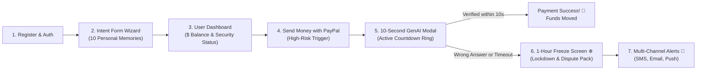

# 🎨 PayShield AI — Master UI/UX Showcase & Screen-by-Screen Demo Walkthrough

> This document presents the **complete visual preview and interactive UI wireframes** of PayShield AI once completed.  
> It provides exact layout blueprints for **DEV 3 (Frontend Lead)** and **DEV 4 (UI Developer)** to implement in Next.js 15, Tailwind CSS, and Shadcn UI.

---

## 🧭 Application Flow Map



---

## 🖥️ Screen 1: Registration & Onboarding (`/register`)

```
┌─────────────────────────────────────────────────────────────────────────────┐
│  🛡️ PayShield AI                [ Features ]  [ Security ]    [ Sign In ]   │
├─────────────────────────────────────────────────────────────────────────────┤
│                                                                             │
│                  Create Your Cognitive-Protected Account                    │
│        Next-generation financial security powered by private human memory   │
│                                                                             │
│         ┌─────────────────────────────────────────────────────────┐         │
│         │  Full Name                                              │         │
│         │  [ Alice Smith                                        ] │         │
│         │                                                         │         │
│         │  Email Address                                          │         │
│         │  [ alice@example.com                                  ] │         │
│         │                                                         │         │
│         │  Phone Number (for SMS Alerts)                          │         │
│         │  [ +1 (555) 019-2834                                  ] │         │
│         │                                                         │         │
│         │  Password                                               │         │
│         │  [ ••••••••••••••••••                                 ] │         │
│         │  Strength: ▓▓▓▓▓▓▓▓▓▓▓▓▓▓▓▓░░░░ (Strong Argon2id)       │         │
│         │                                                         │         │
│         │  [ ✓ ] I agree to the Cognitive Security Protocol       │         │
│         │                                                         │         │
│         │  ┌───────────────────────────────────────────────────┐  │         │
│         │  │       Create Account & Setup Intent Vault ➔       │  │         │
│         │  └───────────────────────────────────────────────────┘  │         │
│         └─────────────────────────────────────────────────────────┘         │
│                                                                             │
│               Already have an account? [ Sign in here ]                     │
└─────────────────────────────────────────────────────────────────────────────┘
```

---

## 🧠 Screen 2: The Flagship 4-Step Intent Form Wizard (`/intent-form`)

> **Built by DEV 4**. This is the core onboarding screen where the user deposits 10 un-Googleable memories into the encrypted vault.

```
┌─────────────────────────────────────────────────────────────────────────────┐
│  🛡️ PayShield AI            Step 2 of 4: Memory Anchors          [ Skip ✕ ] │
├─────────────────────────────────────────────────────────────────────────────┤
│                                                                             │
│   [ 1. Categories ] ──► [ 2. Memory Anchors ] ──► [ 3. Patterns ] ──► [ 4. Vault Lock ]
│   ══════════════════════════════════════════                                │
│                                                                             │
│               🔐 Personal Memory Secret #1 (Childhood Anchor)               │
│   Provide an intimate personal truth that nobody on social media can search.│
│                                                                             │
│   ┌───────────────────────────────────────────────────────────────────────┐ │
│   │ Prompt Preset:                                                        │ │
│   │ [ What secret pet name did your grandmother call you when sick?   ▼ ] │ │
│   │                                                                       │ │
│   │ Your Secret Answer (Keep to 1–3 words):                               │ │
│   │ [ Sunshine                                                          ] │ │
│   │                                                                       │ │
│   │ 💡 Hint: Tolerate casual spelling. The GenAI Agent evaluates intent.  │ │
│   └───────────────────────────────────────────────────────────────────────┘ │
│                                                                             │
│   ┌───────────────────────────────────────────────────────────────────────┐ │
│   │ Prompt Preset:                                                        │ │
│   │ [ Name of your first childhood dog and their favorite snack:      ▼ ] │ │
│   │                                                                       │ │
│   │ Your Secret Answer:                                                   │ │
│   │ [ Bruno who loved biscuits                                          ] │ │
│   └───────────────────────────────────────────────────────────────────────┘ │
│                                                                             │
│   Vault Progress: [ ▓▓▓▓▓▓▓▓▓▓▓▓░░░░░░░░ ]  6 / 10 Secrets Configured       │
│                                                                             │
│   [ ◄ Back ]                               [ Save & Continue to Patterns ➔ ] │
└─────────────────────────────────────────────────────────────────────────────┘
```

---

## 📊 Screen 3: User Financial Dashboard (`/dashboard`)

```
┌─────────────────────────────────────────────────────────────────────────────┐
│  🛡️ PayShield AI       [ Dashboard ]  [ Transfers ]  [ Security ]   👤 Alice▼ │
├─────────────────────────────────────────────────────────────────────────────┤
│                                                                             │
│   Wallet Balance                PayPal Link Status         Security Score   │
│   ┌────────────────────────┐    ┌────────────────────┐     ┌──────────────┐ │
│   │ $ 4,850.00 USD         │    │ 🅿️ Linked & Active │     │ 98% (Secure) │ │
│   │ + $350.00 this week    │    │ Sandbox Connected  │     │ 10 Anchors   │ │
│   └────────────────────────┘    └────────────────────┘     └──────────────┘ │
│                                                                             │
│   ⚡ Quick Actions:  [ 💸 Send with PayPal ]   [ 🛡️ Review Memory Vault ]    │
│                                                                             │
│   Recent Transactions                                                       │
│   ┌───────────────────────────────────────────────────────────────────────┐ │
│   │ Recipient          Date         Amount      Risk Level    Status      │ │
│   ├───────────────────────────────────────────────────────────────────────┤ │
│   │ Coffee House       Today        $ 4.50      Low (0.05)    Auto-Passed │ │
│   │ Tech Store Inc.    Yesterday    $ 280.00    Med (0.42)    AI-Verified │ │
│   │ Unknown Device     Nov 03       $ 1,200.00  High (0.88)   FROZEN ❄️   │ │
│   └───────────────────────────────────────────────────────────────────────┘ │
└─────────────────────────────────────────────────────────────────────────────┘
```

---

## 🅿️ Screen 4: Send Money with PayPal Interception (`/transactions/send`)

> User triggers transfer $\rightarrow$ Standard PayPal checkout opens $\rightarrow$ PayShield detects Risk $\ge 0.30$ and initiates the 10-second cognitive gate!

```
┌─────────────────────────────────────────────────────────────────────────────┐
│  🛡️ PayShield AI                                                    👤 Alice▼ │
├─────────────────────────────────────────────────────────────────────────────┤
│                                                                             │
│                         Send Money Securely via PayPal                      │
│                                                                             │
│   ┌───────────────────────────────────────────────────────────────────────┐ │
│   │ Recipient Email or Phone:                                             │ │
│   │ [ international-merchant@berlin-tech.de                             ] │ │
│   │                                                                       │ │
│   │ Transfer Amount:                                                      │ │
│   │ [ $ 1,200.00 USD                                                    ] │ │
│   │                                                                       │ │
│   │ Transfer Note (Optional):                                             │ │
│   │ [ Late night electronics order                                      ] │ │
│   │                                                                       │ │
│   │ ───────────────────────────────────────────────────────────────────  │ │
│   │                                                                       │ │
│   │                      🅿️ Checkout with PayPal                          │ │
│   │        ┌─────────────────────────────────────────────────────┐        │ │
│   │        │               PayPal  (Official Button)             │        │ │
│   │        └─────────────────────────────────────────────────────┘        │ │
│   │                                                                       │ │
│   │  🛡️ Protected by PayShield Cognitive Interception Protocol           │ │
│   └───────────────────────────────────────────────────────────────────────┘ │
└─────────────────────────────────────────────────────────────────────────────┘
```

---

## ⏱️ Screen 5: The 10-Second Interactive Challenge Modal (THE CORE MOMENT!)

> **Built by DEV 3 & DEV 1**. This modal pops up instantly over the screen when high risk is scored.  
> It has a **live countdown progress bar** pulsing from green $\rightarrow$ yellow $\rightarrow$ red over 10.0 seconds!

```
┌─────────────────────────────────────────────────────────────────────────────┐
│                                                                             │
│        ┌───────────────────────────────────────────────────────────┐        │
│        │ 🛡️ PAYSHIELD COGNITIVE VERIFICATION                       │        │
│        │                                                           │        │
│        │ High-Risk Anomaly Detected ($1,200 at 3:15 AM from Berlin)│        │
│        │ Prove your human identity within the countdown window:    │        │
│        │                                                           │        │
│        │ ⏱️ TIME REMAINING: 06.4s                                   │        │
│        │ [ ▓▓▓▓▓▓▓▓▓▓▓▓▓▓▓▓▓▓▓▓▓▓▓▓▓▓▓▓░░░░░░░░░░ ]  (Pulsing Ring) │        │
│        │                                                           │        │
│        │ ❓ Personal Challenge Riddle:                             │        │
│        │ "Who used to wag their tail and beg for your morning      │        │
│        │  biscuits when you woke up?"                              │        │
│        │                                                           │        │
│        │ Your Answer:                                              │        │
│        │ [ My dog Bruno|                                         ] │        │
│        │                                                           │        │
│        │  ┌─────────────────────────────────────────────────────┐  │        │
│        │  │              Verify & Complete Payment              │  │        │
│        │  └─────────────────────────────────────────────────────┘  │        │
│        │                                                           │        │
│        │ ⚠️ If the timer reaches 0.0s, this transfer will be voided│        │
│        │    and your account will be locked for security.          │        │
│        └───────────────────────────────────────────────────────────┘        │
│                                                                             │
└─────────────────────────────────────────────────────────────────────────────┘
```

---

## ❄️ Screen 6: Emergency 1-Hour Account Lockdown Screen (`/alerts/lockdown`)

> Displayed immediately if an attacker inputs the wrong answer or lets the 10-second timer expire.

```
┌─────────────────────────────────────────────────────────────────────────────┐
│  🛡️ PayShield AI                                             🔒 SECURITY MODE│
├─────────────────────────────────────────────────────────────────────────────┤
│                                                                             │
│                       🚨 ACCOUNT TEMPORARILY FROZEN                         │
│             Unauthorized access attempt blocked before money was moved      │
│                                                                             │
│         ┌─────────────────────────────────────────────────────────┐         │
│         │                                                         │         │
│         │   ❄️ Freeze Status: ACTIVE (1 Hour Security Lock)        │         │
│         │   Time Remaining: 56 minutes, 12 seconds                │         │
│         │                                                         │         │
│         │   Incident Details:                                     │         │
│         │   • Attempted Transfer: $ 1,200.00 USD                  │         │
│         │   • Attacker IP: 185.220.101.5 (Berlin, Germany)        │         │
│         │   • Failure Reason: Failed 10s Cognitive Verification   │         │
│         │   • PayPal Order Status: VOIDED & CANCELLED (Safe ✅)   │         │
│         │   • Incident Reference: PS-FR-2026-9812A                │         │
│         │                                                         │         │
│         │   Actions Taken:                                        │         │
│         │   [ ✓ ] SMS dispatched to +1 (555) 019-2834             │         │
│         │   [ ✓ ] Full forensic incident email sent               │         │
│         │   [ ✓ ] Offending IP submitted to Edge Firewall blocklist│        │
│         │                                                         │         │
│         │   ┌──────────────────────────────────────────────────┐  │         │
│         │   │   📄 Download Bank Dispute Evidence Dossier      │  │         │
│         │   └──────────────────────────────────────────────────┘  │         │
│         │                                                         │         │
│         │   Need urgent access? [ Request Video KYC Recovery ➔ ]   │         │
│         └─────────────────────────────────────────────────────────┘         │
│                                                                             │
└─────────────────────────────────────────────────────────────────────────────┘
```

---

## 📲 Screen 7: Multi-Channel Alerts Visual Mockup

> Dispatched concurrently within **$< 500\text{ms}$** of failure via **DEV 5's Alert Service**.

### 1. Twilio SMS (Delivered to Alice's Mobile Phone)
```text
┌──────────────────────────────────────────────┐
│  Messages • PayShield Security • Now         │
├──────────────────────────────────────────────┤
│ 🚨 ALERT: An unauthorized transfer of        │
│ $1,200.00 was blocked on your PayPal account │
│ from an unknown IP (Berlin).                 │
│                                              │
│ Your account has been FROZEN for 1 hour to   │
│ protect your funds. No money was lost.       │
│                                              │
│ Incident Ref: PS-FR-2026-9812A               │
│ View dossier: https://payshield.ai/a/9812A   │
└──────────────────────────────────────────────┘
```

### 2. SendGrid HTML Forensic Email
```html
┌──────────────────────────────────────────────────────────────────┐
│  🛡️ PAYSHIELD AI SECURITY INCIDENT REPORT                        │
├──────────────────────────────────────────────────────────────────┤
│  Hello Alice,                                                    │
│                                                                  │
│  Our GenAI Verification Agent successfully intercepted and       │
│  blocked an unauthorized transaction on your account.            │
│                                                                  │
│  Incident Summary:                                               │
│  • Timestamp:      November 05, 2026 — 03:15:22 UTC              │
│  • Blocked Amount: $ 1,200.00 USD                                │
│  • Risk Score:     0.88 / 1.00 (Critical Anomaly)                │
│  • Attacker IP:    185.220.101.5                                 │
│  • Device Hash:    fp_98a7bc12d4 (Unknown Linux / Chrome)         │
│  • Verification:   Failed (Timer Expiry at 0.0s)                 │
│  • Action:         1-Hour Account Lockdown Enforced              │
│                                                                  │
│  Your funds are 100% safe. The PayPal authorization was voided. │
│                                                                  │
│  [ Review Security Settings ]       [ Download Bank Evidence PDF ]│
└──────────────────────────────────────────────────────────────────┘
```

---

*PayShield AI UI/UX Design System Showcase — November 2026*
